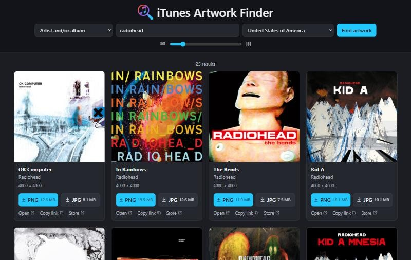

# iTunes Artwork Finder

Find and download **full-resolution album covers and artwork from Apple Music, iTunes, the App Store and Apple Books**: albums, movies, TV shows, apps, audiobooks, books and podcasts, at the largest size Apple has (often 3000 × 3000 or 4000 × 4000), as a lossless PNG or a high-quality JPG.

**[Use it at stevendemanett.com/itunes-artwork-finder →](https://stevendemanett.com/itunes-artwork-finder/)**



## Features

- **Full native resolution.** Requests Apple's largest accepted size, which is capped at the original upload, so you get the real thing, never an upscale.
- **See the size before you download.** Every result shows its native dimensions (e.g. `4000 × 4000`) and the PNG and JPG file sizes, so low-res or non-square scans are easy to spot.
- **Lossless PNG or smaller JPG**, saved through your browser's own download manager (progress, background downloads, several at once).
- **Tidy filenames.** Album covers are named `Artist - Album (Edition) - Front (Hi-Res).png`, with Apple's wording cleaned up (`- EP` → `(EP)`, `Deluxe Version` → `Deluxe Edition`, `Remastered 2023` → `2023 Remastered`) and characters Windows and macOS can't store handled sensibly (`AC/DC` → `AC-DC`).
- **Preview first.** Click any cover for a large preview; arrow keys move between results.
- **Every store and country.** Search albums, Apple IDs, iPhone, iPad and Mac apps, audiobooks, books, music videos, movies, podcasts, short films and TV shows in 150+ country storefronts.
- **Shareable searches.** The URL holds the search, so links and bookmarks reopen the same results.
- **Works with AI agents (WebMCP).** In browsers that support [WebMCP](https://github.com/webmachinelearning/webmcp), an agent can search, check sizes, preview and download artwork through the page's tools instead of clicking around it.

## How it works

A small React app plus a Cloudflare Worker:

- **Search** runs in your browser against the [iTunes Search API](https://performance-partners.apple.com/search-api) (`shared/itunes.ts`). Apple rate-limits requests from Cloudflare's shared Worker IPs, so searches come from each visitor instead.
- **Sizes** (`/api/meta`): the Worker uses HTTP Range requests to read each image's native dimensions and file sizes without downloading the whole file.
- **Downloads** (`/api/download`): the Worker streams the image from Apple's CDN with `Content-Disposition: attachment`, so the file arrives with the right name. Only `*.mzstatic.com` URLs are accepted, so it can't be used as an open proxy.
- Artwork URLs use Apple's `10000x10000-999` size. Larger sizes are rejected, and the old `/us/r1000/0/` "uncompressed" source URLs no longer work (HTTP 403).

### Agent tools (WebMCP)

`src/lib/webmcp.ts` registers four tools with `document.modelContext` when the browser supports it, and does nothing otherwise:

| Tool | What it does |
|---|---|
| `search_artwork` | Searches by query, type and country, shows the results on the page and returns their ids |
| `get_artwork_details` | Native dimensions, PNG/JPG sizes, download filename and full-size URLs for one result |
| `preview_artwork` | Opens the on-screen preview of one result |
| `download_artwork` | Downloads one result as PNG or JPG through the browser |

Everything an agent does happens visibly on the page. WebMCP is a proposed standard; in Chrome it is available behind `chrome://flags/#enable-webmcp-testing` and as an origin trial (set `VITE_WEBMCP_ORIGIN_TRIAL_TOKEN` in `.env` to enable it on your domain). Google's [Model Context Tool Inspector](https://chromewebstore.google.com/detail/model-context-tool-inspec/gbpdfapgefenggkahomfgkhfehlcenpd) extension lets you list and call the tools by hand.

The app is served under the base path `/itunes-artwork-finder`, set in `vite.config.ts` and `worker/index.ts`.

## Run it yourself

Requires Node.js 22+ and a free [Cloudflare](https://dash.cloudflare.com/sign-up) account for deployment.

```sh
npm install
npm run preview      # build, then serve the app and Worker at http://localhost:8787
```

For front-end hot reload, run `npm run dev:worker` and `npm run dev` in two terminals (Vite proxies `/api` to the Worker). After rebuilding, restart `wrangler dev` so it picks up the new files.

### Deploy to Cloudflare Workers

```sh
npx wrangler login
npm run deploy
```

With no other setup this deploys to `itunes-artwork-finder.<your-subdomain>.workers.dev/itunes-artwork-finder/`.

To serve it on your own domain, copy `.env.example` to `.env` (gitignored) and set:

- `DEPLOY_ROUTES`: comma-separated Worker routes, e.g. `example.com/itunes-artwork-finder*`. The domain must be on Cloudflare with its DNS record proxied. With routes set, the workers.dev address is turned off.
- `VITE_SITE_URL`: the public URL, used for the canonical link and social-preview tags.

`npm run deploy` builds and passes those routes to `wrangler deploy`. Deploying without them leaves existing routes in place. To take the app off your domain, delete the routes in the Cloudflare dashboard (Workers & Pages → your Worker → Settings → Domains & Routes).

Static files are served free without counting toward the Workers free plan's 100,000 requests a day; only size lookups and downloads do.

## Credits

Originally based on Ben Dodson's [iTunes Artwork Finder](https://github.com/bendodson/itunes-artwork-finder). Rebuilt with Vite, React, TypeScript and Cloudflare Workers.

Artwork belongs to its respective owners and is provided by Apple. This project is not affiliated with Apple.
